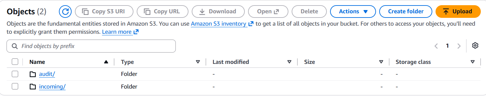
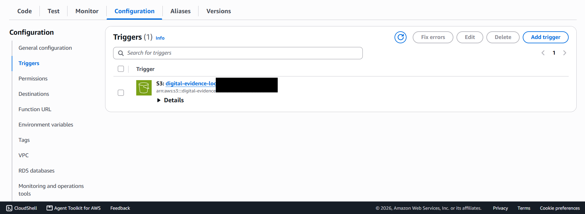
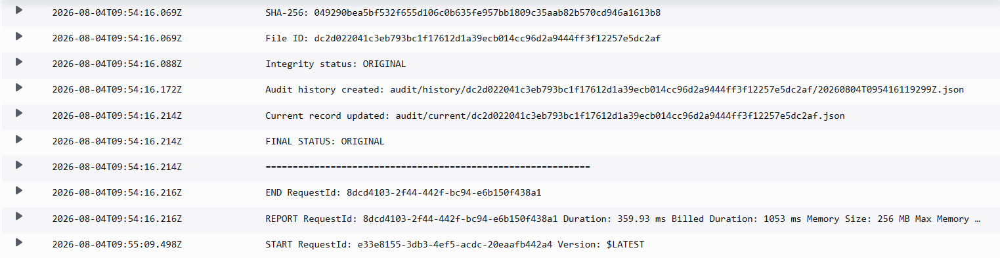
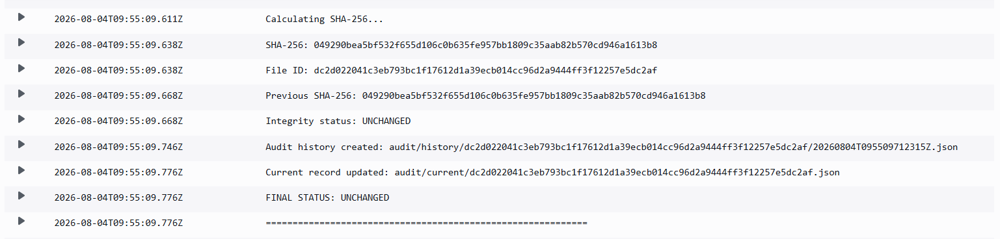
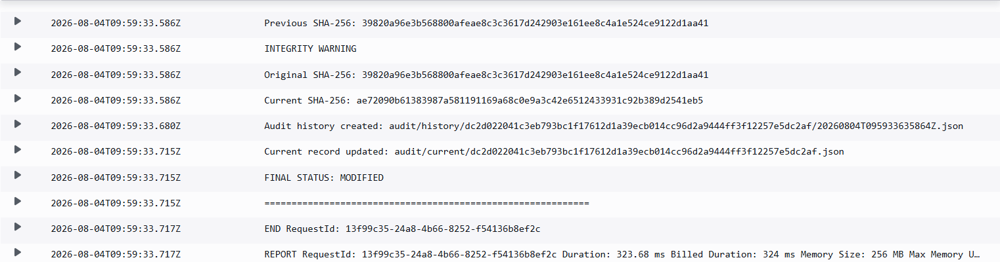
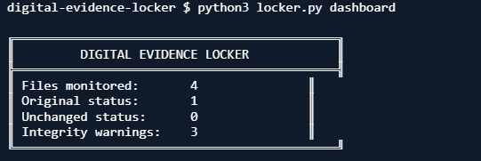

# AWS Digital Evidence Locker

A serverless file-integrity monitoring system built with AWS.

Files uploaded to S3 are automatically fingerprinted, compared against
their last known state, and recorded in a tamper-evident, hash-linked
audit trail — with a companion CLI for inspecting the results.

---

## Problem

Once a file leaves your hands — uploaded to storage, shared, archived —
you generally have no reliable way to know later whether it's still the
same file. Manual checksums require someone to remember to run them,
compare them, and keep a record. That doesn't scale, and it's easy to
tamper with a single stored hash if there's nothing linking it to a
verifiable history.

## Solution

This project turns an S3 bucket into a self-auditing evidence locker.
Every file uploaded to `incoming/` is automatically:

1. Fingerprinted with SHA-256
2. Compared against its previous recorded state
3. Classified as `ORIGINAL`, `UNCHANGED`, or `MODIFIED`
4. Logged as a new, cryptographically-linked audit record

No manual step is required — the moment a file lands in S3, the Lambda
function processes it and the CLI can immediately report on it.

## Architecture

```
                 ┌─────────────┐
                 │     User    │
                 └──────┬──────┘
                        │
                        ▼
                ┌───────────────┐
                │   Amazon S3   │
                │   incoming/   │
                └───────┬───────┘
                        │
                  ObjectCreated
                        │
                        ▼
                ┌───────────────┐
                │ AWS Lambda    │
                │ SHA-256       │
                │ comparison    │
                └───────┬───────┘
                        │
              ┌─────────┴─────────┐
              ▼                   ▼
       audit/current/      audit/history/
              │                   │
              └─────────┬─────────┘
                        ▼
                 CloudWatch Logs
```

See [`docs/architecture.md`](docs/architecture.md) for a full breakdown
of the data flow, record format, and hash-chaining design.

## Demonstration

The system was tested through a complete file-integrity workflow:

1. A new file is uploaded → `ORIGINAL`
2. The same file is uploaded again → `UNCHANGED`
3. The file content is changed → `MODIFIED`
4. The CLI provides a dashboard for inspecting the resulting records

### S3 Storage



### Event-Driven Processing



### Original File Detection



### Unchanged File Detection



### Modified File Detection



### CLI Dashboard



## Features

- **SHA-256 fingerprinting** — every file is hashed on upload by
  streaming it in chunks, so large files don't need to fit in memory
- **Automatic classification** — `ORIGINAL` (first time seen),
  `UNCHANGED` (hash matches last record), or `MODIFIED` (hash differs)
- **Tamper-evident audit chain** — each audit record embeds the hash of
  the previous record for that file (`previous_record_hash`) and is
  itself hashed (`audit_record_hash`), so altering a past record breaks
  the chain of every record after it
- **Full historical trail** — every processing event is preserved under
  `audit/history/`, in addition to a fast-access `audit/current/` pointer
  to the latest state
- **CloudWatch logging** — every step of processing is logged for
  observability and debugging
- **Python CLI dashboard** — `locker.py` reads directly from S3 and
  provides:
  - `dashboard` — summary counts by integrity status
  - `list` — table of all monitored files
  - `verify` — detailed per-file integrity report
  - `history` — full chronological audit trail, including the hash chain

## Project Structure

```
aws-digital-evidence-locker/
├── src/
│   ├── lambda_function.py     # S3-triggered integrity processor
│   └── locker.py               # CLI dashboard
├── docs/
│   ├── architecture.md         # detailed design notes
│   └── screenshots/            # demonstration screenshots
├── examples/
│   ├── original/               # sample "first seen" file (see note in folder)
│   ├── modified/               # sample files showing a modification
│   └── audit-records/          # sample exported audit JSON (see note in folder)
└── deployment/
    ├── README.md                # step-by-step deployment guide
    ├── AWS_CONFIGURATION.txt    # sanitized reference configuration
    └── lambda-configuration.json # sanitized reference Lambda config
```

## Getting Started

See [`deployment/README.md`](deployment/README.md) for full setup
instructions, including required IAM permissions and how to reproduce
this project in your own AWS account.

## Origin

This project was originally built and demonstrated in an AWS Academy
Learner Lab (sandbox) environment. Sandbox resources are temporary and
tied to a training account, so this repository preserves the source
code, architecture, and evidence permanently — it does not depend on
the original sandbox to be understood or redeployed.

## License

MIT — see [`LICENSE`](LICENSE).
